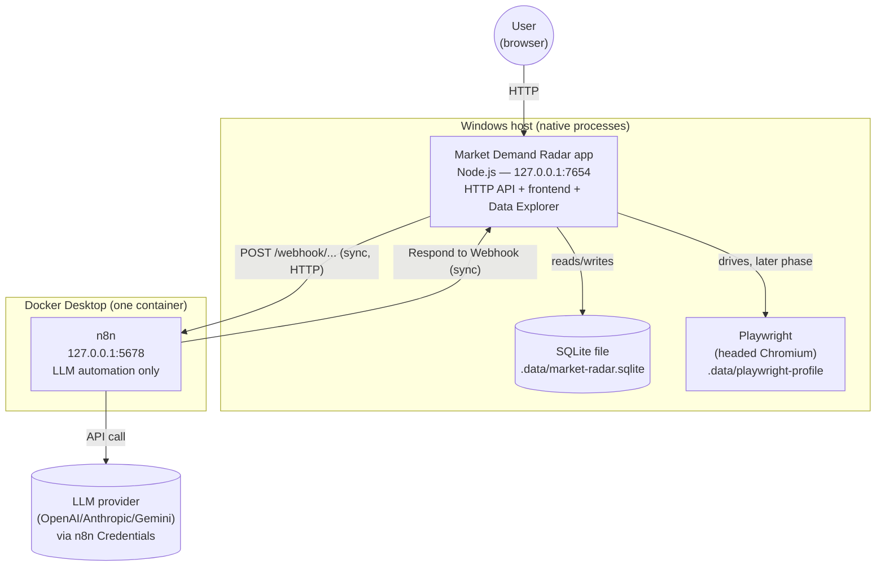

# 02 — Local Topology

## Processes on the developer's Windows machine

| Process | How it runs | Port | Owns |
|---|---|---|---|
| Market Demand Radar app | native Node.js process (`npm run dev` / `node server.js`) | `127.0.0.1:7654` | HTTP API, frontend, SQLite file, Playwright driver, pipeline/orchestration logic, Data Explorer |
| n8n | single Docker container (Docker Desktop) | `127.0.0.1:5678` | LLM prompt orchestration for MR-01/MR-02 only |
| Playwright browser | native Windows process, launched by the app, persistent profile on disk | n/a (not network-exposed) | Nothing durable; the app owns everything the browser observes |

Nothing else runs in Docker. No Postgres, no Redis, no reverse proxy, no message broker.

## Diagram — local development

Key properties of this diagram:

- The **only** arrow crossing the Docker boundary is a synchronous HTTP request/response
  initiated by the app. n8n never initiates a connection back into the app.
- Playwright is drawn as a later-phase edge (dashed conceptually) — this repository's current
  scope stops before wiring it up; see [10-playwright-boundary.md](10-playwright-boundary.md).
- SQLite is exclusively owned and written by the app process. n8n cannot see it and never
  should.

## Ports and addressing

| Address | What | Binding |
|---|---|---|
| `http://127.0.0.1:7654` | Market Demand Radar app | native process, loopback only in dev |
| `http://127.0.0.1:5678` | n8n editor UI + webhooks | Docker port published as `127.0.0.1:5678:5678` (not `0.0.0.0`) — deliberately not reachable from other machines on the LAN |

Binding n8n to `127.0.0.1` instead of all interfaces is a conscious security choice for a
developer machine: it prevents anything else on the local network from reaching the n8n editor
or invoking its webhooks, at zero cost to the app (which runs on the same host).

## Volumes / persistent state

| Path | Owner | Contents |
|---|---|---|
| `.data/market-radar.sqlite` | app | all application data (projects, plans, runs, later: ads/advertisers) |
| `.data/playwright-profile/` | app (Playwright) | persistent browser profile — **not** the user's real Chrome profile |
| Docker named volume `n8n_data` → `/home/node/.n8n` | n8n container | n8n's own SQLite DB, credentials (encrypted), encryption key, execution logs |

The app's data directory and the n8n Docker volume are **independent, physically separate
databases with no shared schema**. This is intentional: it removes an entire category of
migration/lock-in problems and matches the "n8n is not the database" rule in
[03-n8n-boundary.md](03-n8n-boundary.md).

## Why not run everything in Docker?

Explicitly rejected for this MVP, per the brief's constraints and the following reasoning:

- **Playwright in Docker on Windows** fights Docker Desktop's WSL2/Hyper-V backend for
  headed-mode rendering, GPU access, and file-based persistent profiles. Headed mode is
  valuable during collector development (see [10](10-playwright-boundary.md)) precisely
  because you can *watch* what the page is doing.
- **SQLite in Docker** adds a volume-permission and file-locking layer for zero benefit — the
  app is already native, so the database might as well be a plain file next to it.
- **The app in Docker** would mean two different execution/debugging models (native + Docker)
  for one codebase, purely for symmetry with n8n. Not worth it for a project this size.

## What changes when n8n moves to a VPS

Nothing here. Only `N8N_BASE_URL` (and related webhook path/secret config) changes. See
[04-future-vps-switch.md](04-future-vps-switch.md).
