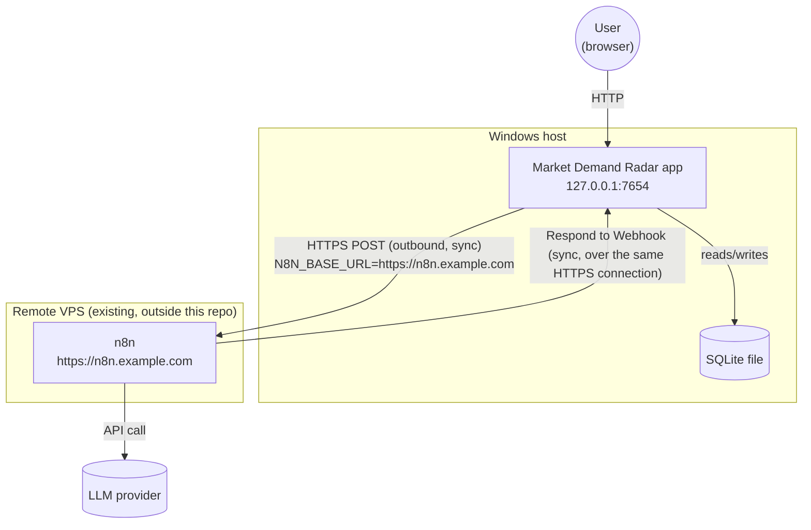

# 04 — Future VPS Switch

The user already runs a separate n8n instance on a VPS and wants to be able to stop using the
local Docker n8n and point the app at the VPS instance later — **without changing application
code**.

## Diagram — after moving n8n to a VPS

The only structural difference from the local diagram in [02](02-local-topology.md) is that
the arrow into n8n now crosses the public internet over HTTPS instead of loopback HTTP. The
app **always initiates** the connection; the VPS never needs to reach into the user's machine.
This is why no callback/tunnel infrastructure is required for the current synchronous design.

## What has to change to switch: configuration only

| Variable | Local value | VPS value |
|---|---|---|
| `N8N_BASE_URL` | `http://127.0.0.1:5678` | `https://n8n.example.com` |
| `N8N_GENERATE_PLAN_PATH` | `/webhook/mr01-generate-plan` | same path, or whatever the VPS workflow uses |
| `N8N_REVISE_PLAN_PATH` | `/webhook/mr02-revise-plan` | same path, or whatever the VPS workflow uses |
| `N8N_REQUEST_TIMEOUT_MS` | generous (LLM calls can be slow) | same, possibly increased for network latency |

> **FUTURE WORK — not designed yet:** authentication/security for a remote n8n is explicit
> future work and **must be designed before exposing the integration over the internet**. Local
> MVP deliberately ships with no app↔n8n authentication at all (see
> [09-security.md](09-security.md)) because both sides are loopback-only. Moving to a VPS
> without first designing this is a real vulnerability, not a config detail — do not skip it or
> assume the eventual scheme is "just add a shared secret"; evaluate header-secret,
> HMAC-signed requests, mTLS, or a fronting reverse-proxy allowlist on their merits at that
> time, in a new ADR.

No application code, no database schema, and no `DiscoveryPlanV1` contract change is required
for the base URL/path switch itself. This is the point of treating n8n as an HTTP dependency
invoked via synchronous, stateless-per-call requests, with no Market Demand Radar application
data stored inside n8n itself (see [07-api-contract.md](07-api-contract.md) for the exact
client module shape this implies: a single `n8nClient` reads these env vars and nothing else
in the app talks to n8n directly).

## Test webhook URL vs. production webhook URL vs. active/inactive

n8n gives every Webhook node two URLs:

- **Test URL** — only responds while the workflow is open in the editor and you've clicked
  "Listen for test event" (or the workflow is executed manually). Useful during workflow
  development, but not what the app should call.
- **Production URL** — only responds once the workflow is **activated/published**. This is the
  URL the app's `N8N_GENERATE_PLAN_PATH` / `N8N_REVISE_PLAN_PATH` must point at.

Implication: **MR-01 and MR-02 must be activated/published in every environment** (local
Docker n8n and VPS n8n) before the app can call them. This is a manual, one-time step per
environment and should be listed explicitly in the setup docs and in
[13-acceptance-tests.md](13-acceptance-tests.md) as a precondition.

## HTTPS, authentication, timeouts, retry — differences to design for

| Concern | Local | VPS |
|---|---|---|
| Transport | plain HTTP over loopback (acceptable; never leaves the machine) | HTTPS required (already true if the user's VPS n8n is behind a reverse proxy with TLS, which is the standard n8n VPS setup) |
| Auth | none configured (loopback-only, developer machine) | **FUTURE WORK, not designed yet** — must be decided before going live; see the callout above and [09-security.md](09-security.md) |
| Timeout | generous, since local LLM round trips can still take 10–30s+ | same base timeout, but add margin for network latency and cold starts |
| Retry | app performs zero automatic retries on failure classes that aren't clearly transient (see [07](07-api-contract.md) error taxonomy) | same policy; a flaky network is not a reason to introduce silent retries that could double-submit an LLM generation — idempotent `requestId` handling (see [07-api-contract.md](07-api-contract.md)) protects against this either way |

## Credential migration is not workflow migration

Moving n8n to a VPS involves two separate concerns that must not be conflated:

1. **Workflow migration** — moving the MR-01/MR-02 workflow *definitions* (nodes, prompts,
   schema reference) between instances. Community Edition n8n has no Git-based Source Control;
   this is done via manual JSON export/import or the Server CLI (see
   [n8n/README.md](../../n8n/README.md)).
2. **Credential migration** — moving/recreating the LLM provider credential (and, later, any
   app↔n8n auth credential) in the new instance. Credentials are encrypted with each n8n
   instance's own encryption key (see [09-security.md](09-security.md)); do not assume the VPS
   instance uses, or should use, the same key as local. In practice this means: **re-create
   credentials manually in the VPS instance's GUI** rather than trying to copy encrypted
   credential data across instances.

Treat these as two separate manual steps in the future VPS-migration runbook, not one.

## Why not design async/callback support now

The brief explicitly rules this out for the current phase, and the reasoning holds up:

- A VPS-hosted n8n **cannot** call back into `http://localhost:7654` — there is no route from
  the public internet to a developer's home/office machine without extra infrastructure
  (tunnel, polling, public callback endpoint, message queue, outbound WebSocket).
- Synchronous request/response is sufficient for "generate a plan" and "revise a plan" — both
  are deliberate, occasional, human-in-the-loop actions where waiting a few seconds/tens of
  seconds for a response is acceptable UX, not a hot path needing async handling.

### Menu of async patterns (documented for later, not implemented)

If a future workflow genuinely needs to be long-running/async (e.g. a multi-minute batch
enrichment job), the options to evaluate at that time are:

1. **Polling** — app submits a job to n8n, gets a job id back immediately, polls
   `GET /webhook/job-status/:id` until done. Simple, no inbound connectivity needed to the app.
   Adds polling-interval latency and a bit of client complexity.
2. **Public callback endpoint secured over HTTPS** — the app would need a public HTTPS
   endpoint (not just `127.0.0.1:7654`), e.g. behind a reverse proxy/tunnel, so the VPS n8n can
   `POST` results back. Real infra to stand up and secure (auth, replay protection).
3. **Tunnel** (e.g. Cloudflare Tunnel, ngrok) — exposes the local app temporarily so a remote
   n8n can call back. n8n's own docs flag their bundled tunnel feature as **development-only,
   not safe for production**. Would need its own security review before ever using it for
   anything beyond manual testing.
4. **Queue** (e.g. a hosted queue/broker) — decouples submission from processing entirely.
   Meaningful infra addition; not justified without a concrete async use case.
5. **Outbound WebSocket** — app opens a long-lived WebSocket to the VPS n8n (or a small relay)
   and receives pushed results. Avoids inbound connectivity to the app, but is non-trivial to
   implement reliably (reconnect/backoff, message ordering) for the benefit it gives today.

None of these are built now. If/when they are needed, pick based on: how long the job runs,
how many jobs run concurrently, and whether the app can tolerate polling latency.
