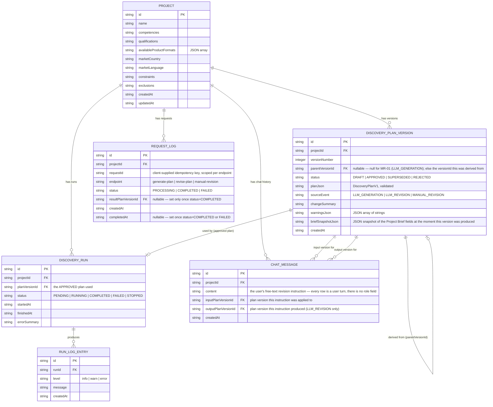
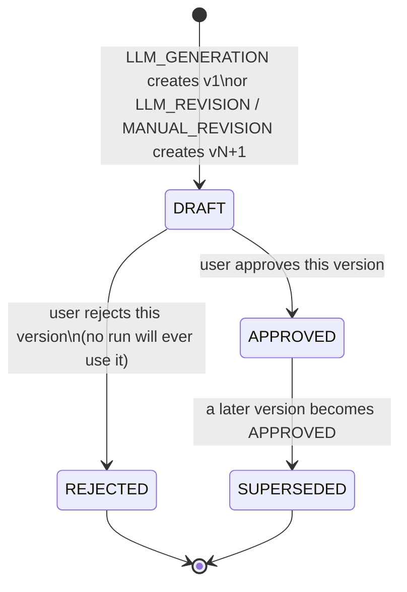

# 05 — Data Model

All data lives in one SQLite file owned exclusively by the app: `.data/market-radar.sqlite`.
n8n never reads or writes it (see [03-n8n-boundary.md](03-n8n-boundary.md)).

## Entity overview

## Table notes

### `Project`

The capability boundary described in [01-product-model.md](01-product-model.md). Free-text
fields are stored as-is; `availableProductFormats` is stored as a JSON-encoded array of enum
strings for simplicity (SQLite has no native array type, and this field is never queried by
individual value in the MVP — a join table would be premature normalization).

### `DiscoveryPlanVersion`

The append-only, versioned history of `DiscoveryPlanV1` documents for a project.

- **Never updated in place**, regardless of how the new version was produced:
  - `sourceEvent = LLM_GENERATION` — MR-01 creates version 1 (`status=DRAFT`).
  - `sourceEvent = LLM_REVISION` — MR-02 creates a new version from a free-text user
    instruction (produces a `changeSummary`/`warnings` pair from the LLM).
  - `sourceEvent = MANUAL_REVISION` — the user directly edits the plan in the UI (toggle a
    query on/off, edit text, remove an item) with **no LLM call involved**. This is a
    first-class, equally-supported way to produce a new version — not a fallback for when the
    LLM is unavailable. The app builds the `changeSummary` for this case from the user's own
    description of what they changed (see `POST /discovery-plans/:versionId/manual-revision`
    in [07-api-contract.md](07-api-contract.md)); `warnings` is set to `[]` unless the app's own
    structural validation produced non-fatal notices.
  - All three cases always reference the previous version explicitly through the new
    `parentVersionId` field, in addition to `changeSummary`.
- **Plan lineage (`parentVersionId`)**: records actual derivation, independent of
  `versionNumber`.
  - `sourceEvent=LLM_GENERATION` (MR-01) → `parentVersionId = NULL` (nothing to derive from).
  - `sourceEvent=LLM_REVISION` (MR-02) → `parentVersionId` = the `versionId` supplied in the
    `POST /discovery-plans/:versionId/revise` call (see
    [07-api-contract.md](07-api-contract.md)).
  - `sourceEvent=MANUAL_REVISION` → `parentVersionId` = the `versionId` supplied in the
    `POST /discovery-plans/:versionId/manual-revision` call.
  - `parentVersionId` is **set once at creation and never inferred from `versionNumber`** —
    `versionNumber` only records "how many versions this project has had, in creation order"
    (monotonically increasing per `Project`) and says nothing about which version a given
    version was actually derived from. The two can diverge in ordinary use (e.g. two draft
    branches created from the same approved parent before either is approved), and the app,
    the Data Explorer, and any future UI must always read `parentVersionId` — never reconstruct
    ancestry by looking at `versionNumber - 1`.
  - This delivery does **not** build any branching UI (no compare-branches view, no tree
    picker) — the only requirement is that lineage is correctly persisted and readable via the
    Data Explorer's plain table view of `DiscoveryPlanVersion` rows.
- **State machine:**

  Only one version per project may be `APPROVED` at a time. Approving a new version
  automatically flips the previously `APPROVED` version to `SUPERSEDED` — an application-level
  invariant enforced in a single transaction, not a database constraint (SQLite doesn't have
  a clean way to express "at most one row per `projectId` with `status=APPROVED`" declaratively
  without triggers, and a straightforward app-level transaction is easier to reason about than
  a trigger for this MVP).
- `planJson` stores the full validated `DiscoveryPlanV1` object as a JSON text column. It is
  validated against [DiscoveryPlanV1.schema.json](DiscoveryPlanV1.schema.json) **before**
  insertion — never stored unvalidated (see [06](06-discovery-plan-contract.md)) — including a
  structural check that every `id` across the plan's item arrays is unique and well-formed (see
  "Stable IDs" in [06](06-discovery-plan-contract.md)).
- `briefSnapshotJson` stores a plain JSON copy of the `Project` brief fields exactly as they
  were at the moment this version was produced (not a reference to the live `Project` row,
  which may be edited later). This is a simple point-in-time snapshot — there is no separate
  `ProjectBriefVersion` versioning system; the brief is not independently versioned, only
  captured alongside each plan version for traceability.

### `ChatMessage`

The chat-style revision history behind MR-02 ("Plan chat" screen in
[01-product-model.md](01-product-model.md)). Only **LLM-driven** revisions produce a row here —
a free-text `content` (the user's instruction) is meaningless for a manual revision, which has
no natural-language instruction to record; manual revisions are recorded solely via their
`DiscoveryPlanVersion` (`sourceEvent=MANUAL_REVISION`, `changeSummary`).

**No `role` field.** Every `ChatMessage` row is a user instruction — there is nothing else to
tag with a role. The "assistant reply" half of a chat turn is never persisted as its own row;
it is reconstructed at render time by reading the linked `DiscoveryPlanVersion.changeSummary`
and `.warningsJson` for that row's `outputPlanVersionId`. This is deliberately the simplest
model that satisfies the Plan Chat UI: storing a second, LLM-authored row per turn would just
duplicate data that already lives on `DiscoveryPlanVersion`, for no benefit. System prompts are
internal to the n8n workflow and are **never** persisted as `ChatMessage` rows under any role.

Each row unambiguously maps one chat turn to the plan versions it connects:

- `inputPlanVersionId` — the version the user was looking at when they typed the instruction.
- `outputPlanVersionId` — the new version MR-02 produced from that instruction. `NULL` only in
  the narrow window between "request sent" and "response received/persisted"; a failed MR-02
  call does not leave a dangling row (see error handling in
  [07-api-contract.md](07-api-contract.md)).

Only the **recent** slice of this history (by `createdAt`, scoped to the project) is sent to
MR-02 as context (see [08-n8n-workflows.md](08-n8n-workflows.md)) — the full history is never
replayed in one prompt. When assembling that context, the app pairs each `ChatMessage.content`
(as a `user` turn) with the reconstructed `changeSummary` of its `outputPlanVersionId` (as an
`assistant` turn) — see [07-api-contract.md](07-api-contract.md) for the exact shape sent to
MR-02.

### `RequestLog`

Backs idempotency for the three plan-producing endpoints (`generate-plan`, `revise-plan`,
`manual-revision`) — see [07-api-contract.md](07-api-contract.md) for the full behavior.

**Constraint: `UNIQUE(endpoint, requestId)`** — not a bare `UNIQUE(requestId)`. `requestId` is
an idempotency key scoped to a single endpoint, never a global key; this document and
[07-api-contract.md](07-api-contract.md) must consistently say "per `(endpoint, requestId)`",
never "globally unique `requestId`".

**Atomic reservation, before any work happens — not a write-after-the-fact log.** The row is
inserted with `status=PROCESSING` **before** MR-01/MR-02 is called or a manual revision is
validated. The `UNIQUE(endpoint, requestId)` constraint on that insert is what makes the
reservation atomic: if two requests carrying the same `(endpoint, requestId)` race each other,
exactly one insert succeeds; the other fails immediately on the constraint and is treated as
"this request is already in flight" (see lifecycle below) — this is what actually protects
against two concurrent identical requests, which a log written only after the operation
completes cannot do.

**Lifecycle:**

1. Insert `RequestLog(status=PROCESSING, resultPlanVersionId=NULL, completedAt=NULL)`. If this
   insert fails on the `UNIQUE(endpoint, requestId)` constraint, another request already owns
   this key (go to "repeat while `PROCESSING`" below instead of proceeding).
2. Perform the operation (call n8n, or validate the manual edit's structural diff).
3. On success: persist the new `DiscoveryPlanVersion`, then update the same row to
   `status=COMPLETED`, `resultPlanVersionId=<new version id>`, `completedAt=now()`.
4. On failure: update the same row to `status=FAILED`, `completedAt=now()`;
   `resultPlanVersionId` stays `NULL`. Nothing is persisted as a `DiscoveryPlanVersion`.

**Repeat behavior** (exact HTTP shape in [07-api-contract.md](07-api-contract.md)):

- **While `PROCESSING`**: the repeat's own insert fails the unique constraint; the app makes
  **no** n8n call for the repeat and returns a deterministic `REQUEST_IN_PROGRESS` response.
- **After `COMPLETED`**: the app returns the same `resultPlanVersionId`'s
  `DiscoveryPlanVersion`; no new n8n call, no new version.
- **After `FAILED`**: the app returns the recorded failure; still no automatic retry — the user
  must perform a new action with a **new** `requestId` to try again. A `FAILED` row is a dead
  end by design, never auto-resurrected.

This is a plain unique-constraint insert/update, not a job queue — there is no background
processing to coordinate.

### `DiscoveryRun` / `RunLogEntry`

Deferred in behavior (no Playwright collector yet) but modeled now because
`DiscoveryPlanV1.discoveryLimits` and `saturationCriteria` exist specifically to bound a future
run. `RunLogEntry` is a simple append-only log table, not a generic event bus — good enough for
a single-user local tool.

## Migrations

A plain, ordered SQL migration folder (e.g. `db/migrations/0001_init.sql`,
`0002_....sql`) applied at app startup, tracked in a `schema_migrations` table. No ORM is
mandated; a lightweight query layer (e.g. `better-sqlite3` directly, or a thin wrapper) is
sufficient given the small, stable schema above. This choice is left to
[codex-implementation-brief.md](codex-implementation-brief.md) to finalize, since it doesn't
affect any cross-system contract.
