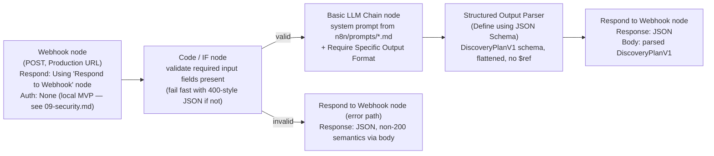

# 08 — n8n Workflows (MR-01 / MR-02)

Two workflows, both hand-authored in the n8n editor and exported as JSON into
`n8n/workflows/` (see [Phase B skeleton](../../n8n/README.md)). Both follow the same shape.

## Why Basic LLM Chain + Structured Output Parser, not AI Agent

Verified from n8n's official node docs:

- The **AI Agent** node (Tools Agent, the only agent type since n8n 1.82+) is built for
  multi-step, autonomous tool-calling loops — it requires at least one connected tool sub-node
  and is designed for tasks where the model decides what to do next.
- The **Basic LLM Chain** node is a single deterministic prompt → response step, with an
  optional "Require Specific Output Format" toggle that connects an output-parser sub-node
  (Auto-fixing Output Parser / Item List Output Parser / **Structured Output Parser**).

MR-01/MR-02 are both "take a fixed input, produce one JSON object matching a fixed schema" —
there is no multi-step tool use, no decision-making about what to fetch next. This is exactly
the Basic LLM Chain's use case, and using AI Agent here would add latency, cost, and
non-determinism (the agent loop, tool-selection reasoning) with no corresponding benefit. This
is a direct instance of the "don't reach for AI Agent just because it exists" principle from
the original brief.

## Workflow shape (identical structure for MR-01 and MR-02)

### Node-by-node notes

1. **Webhook node**
   - HTTP Method: `POST`.
   - Respond: **"Using 'Respond to Webhook' Node"** (required — this is the only respond mode
     that lets a later node in the workflow control the reply, which we need in order to
     return the LLM's structured output).
   - Authentication: **None** for local MVP use. n8n's Webhook node supports Basic/Header/JWT/
     None auth, but n8n is bound to `127.0.0.1` only (see
     [02-local-topology.md](02-local-topology.md)), so nothing off-machine can reach this
     webhook regardless of auth mode — adding one now would just be setup friction with no
     real benefit. Designing real app↔n8n authentication is explicit **future work** before any
     VPS move (see [09-security.md](09-security.md), [04-future-vps-switch.md](04-future-vps-switch.md)).
   - The app must call the **Production URL**, and the workflow must be **activated/published**
     in the editor for that URL to respond (the Test URL only works while "Listen for test
     event" is active in the editor — not suitable for the running app).

2. **Validate input node** (Code node or `IF`/`Filter`)
   - Cheap, deterministic check that required fields exist (`brief.competencies`,
     `brief.market`, etc. for MR-01; `currentPlan`, `userInstruction` for MR-02) **before**
     spending an LLM call on a malformed request.
   - On failure: short-circuits straight to an error-shaped `Respond to Webhook` node instead
     of the happy path — keeps the LLM branch simple and avoids paying for a doomed generation.

3. **Basic LLM Chain node**
   - Prompt text lives in `n8n/prompts/discovery-plan-system.md` (MR-01) and
     `n8n/prompts/revise-plan-system.md` (MR-02) — kept as separate files (not typed inline
     into the node) so prompt wording changes are diffable in git even though the workflow
     itself is JSON.
   - Both prompts must explicitly encode the traction-signal vocabulary rule from
     [01-product-model.md](01-product-model.md): the system prompt is the primary place this
     product-integrity rule is enforced.
   - "Require Specific Output Format" toggle: **on**, output parser: Structured Output Parser.
   - LLM provider credential (OpenAI/Anthropic/Gemini — whichever the user configures) is
     attached to the underlying Chat Model sub-node, stored in n8n's encrypted Credentials
     store. The app never sees or handles this key.

4. **Structured Output Parser node**
   - Mode: **"Define using JSON Schema"**, pasted from
     [DiscoveryPlanV1.schema.json](DiscoveryPlanV1.schema.json) verbatim (already flattened,
     no `$ref` — see [06](06-discovery-plan-contract.md) for why).
   - This node is what turns the LLM's raw text completion into a parsed JSON object (or
     raises a parsing error if the model's output doesn't match).

5. **Respond to Webhook node (happy path)**
   - Response: **JSON**, body: the parsed `DiscoveryPlanV1` object straight from the
     Structured Output Parser's output.
   - Constraint from n8n's docs: `Respond to Webhook` only uses the **first** incoming data
     item. Both workflows must guarantee exactly one item reaches this node (true by
     construction here, since Basic LLM Chain → Structured Output Parser produces one object
     for one input) — called out explicitly so nobody accidentally fans this out with a
     Split/Loop node upstream.

6. **Respond to Webhook node (error path)**
   - A second `Respond to Webhook` node for the "invalid input" branch, returning a JSON error
     body. n8n allows only one `Respond to Webhook` execution per workflow run, so the
     validate step must route to exactly one of the two respond nodes, never both.

## MR-01 specifics — Generate Discovery Plan

- Input: `{ requestId, projectId, brief, availableDiscoveryCapabilities }` (see
  [07-api-contract.md](07-api-contract.md)). `availableDiscoveryCapabilities` is app-provided
  runtime context, not a user input — it constrains which `source`/`mode` values the model may
  use in `discoveryStrategies[]`.
- System prompt responsibilities: restate the brief (`capabilityUnderstanding`), propose
  `seedQueries` (each with `enabled: true` and `source: "LLM_INITIAL"`), `candidateProductTypes`,
  `initialTaxonomy`, `discoveryStrategies` (each `source`/`mode` pair drawn only from
  `availableDiscoveryCapabilities`), `queryExpansionPolicy`, `openUnknowns`, `constraints`
  (carried from the brief), `discoveryLimits` (reasonable defaults if the brief didn't specify),
  `saturationCriteria`.
- `changeSummary` and `warnings` are required by the schema but must be `""` and `[]`
  respectively for a first generation (the prompt must instruct this explicitly, since the
  schema can't express "conditionally required based on which workflow called").

## MR-02 specifics — Revise Discovery Plan

- Input: `{ requestId, projectId, currentPlan, userInstruction, recentConversation,
  availableDiscoveryCapabilities }`.
- System prompt responsibilities: apply `userInstruction` to `currentPlan`, preserving
  everything not affected by the instruction (see "Stable IDs" in
  [06-discovery-plan-contract.md](06-discovery-plan-contract.md) — unchanged/edited items keep
  their `id`, new items get a new `id`, removed items simply disappear), and populate
  `changeSummary` (what changed and why, non-empty) and `warnings` (e.g. "instruction conflicted
  with a stated constraint and was only partially applied"). New `seedQueries` produced by this
  step must be marked `source: "LLM_REVISION"`.
- The **whole previous plan** is passed back in on every revision (not a diff) — this keeps the
  LLM call a single deterministic request/response step and keeps n8n workflow logic simple; the
  app is the one deciding what "current" means (the latest `DRAFT` or `APPROVED` version, per
  its own business rules).
- **Manual revision does not go through this workflow at all** — it's a separate,
  LLM-free app-side path (`POST /discovery-plans/:versionId/manual-revision`, see
  [07-api-contract.md](07-api-contract.md)) that produces a `DiscoveryPlanVersion` directly from
  the user's own edits.

## Repair-on-invalid-output pattern (see also [06](06-discovery-plan-contract.md))

The Structured Output Parser will raise an error if the model's raw output doesn't parse
against the schema. Two acceptable places to implement the "one repair attempt" rule — pick one
in implementation and document the choice in `n8n/README.md`:

- **Inside the workflow**: use the **Auto-fixing Output Parser** wrapping the Structured
  Output Parser, which re-prompts the model once automatically with the validation error, then
  fails the node if still invalid.
- **Outside the workflow, app-side**: the app calls the same webhook a second time with an
  added note about the previous failure, if the first call's response fails the app's own
  schema validation.

Either way: **at most one repair attempt, total**, then a hard failure surfaced to the user.
Never more than one, and never a silent fallback to an unvalidated document.

## Credentials used by these workflows

| Credential | Attached to | Stored where |
|---|---|---|
| LLM provider API key (OpenAI/Anthropic/Gemini) | Chat Model sub-node inside Basic LLM Chain | n8n Credentials store (encrypted with n8n's own auto-generated key — see [09-security.md](09-security.md)) |

This is a **manual, one-time step per environment**: create the credential in n8n's GUI after
importing the workflow, then pin it on the Chat Model sub-node. Workflow JSON exported into
`n8n/workflows/` never requires a pre-configured credential to import successfully — see
[n8n/README.md](../../n8n/README.md) for the exact manual steps.

No credential is ever placed in workflow JSON in plaintext — n8n stores credential *references*
in exported workflow JSON, not the secret values themselves, so `n8n/workflows/*.json` is safe
to commit (see [09-security.md](09-security.md)).
