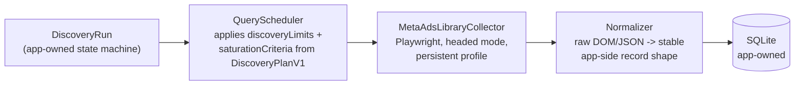

# 10 — Playwright Boundary

**Not implemented in this phase.** This document defines the interface/boundary so that when
the collector *is* built, it slots into the architecture already agreed here instead of
reopening these decisions.

## Why Playwright runs natively, not in n8n or Docker

- Meta Ads Library (and similar ad-transparency surfaces) have **no stable, documented,
  public scraping API** for this use case — selectors, DOM structure, and anti-bot behavior
  will need to be discovered empirically and will drift over time. Guessing selectors now
  (without inspecting the live DOM) would produce a collector that's wrong on day one.
- Headed-mode browser debugging (watching the page while building selectors) is dramatically
  easier natively on Windows than inside Docker Desktop's Linux VM.
- n8n must never drive a browser (see [03-n8n-boundary.md](03-n8n-boundary.md)) — it has no
  Playwright capability of its own and adding one (e.g. via a Code node shelling out) would
  violate the "n8n owns no Market Demand Radar application data / never touches the browser"
  boundary and reintroduce exactly the coupling the VPS-migration design avoids.

## Conceptual pipeline (design only, not built)

- **`DiscoveryRun`**: the app's own state machine (`PENDING → RUNNING → COMPLETED/FAILED/STOPPED`,
  see [05-data-model.md](05-data-model.md)). Owns all status transitions; nothing external
  (including n8n) can change run state.
- **`QueryScheduler`**: reads `seedQueries`, `discoveryLimits`, and `saturationCriteria` from
  the project's `APPROVED` `DiscoveryPlanV1` and decides what to search next and when to stop —
  this is where the plan's guardrails actually get enforced operationally.
- **`MetaAdsLibraryCollector`**: the Playwright-driving component. Talks to the browser only;
  never talks to n8n or the LLM directly.
- **`Normalizer`**: converts whatever raw shape the collector scrapes into a stable internal
  record shape before it touches SQLite — isolates the rest of the app from Meta's DOM/markup
  churn.

## Persistent browser profile

- Path: `.data/playwright-profile/` (see [02-local-topology.md](02-local-topology.md)).
- **Never** the user's real, everyday Chrome profile — a dedicated, disposable Playwright
  profile avoids mixing collector cookies/session state with the user's personal browsing, and
  avoids any risk of the collector inheriting logged-in sessions it shouldn't have access to.
- Persistent (not incognito/ephemeral) so that any manual login/consent/cookie-banner
  interaction done once doesn't need repeating on every run.

## `collector:inspect` — the explicit anti-guessing tool

Because the brief explicitly forbids guessing Meta Ads Library selectors, the collector's
first deliverable (when this phase eventually starts) must be a `collector:inspect` mode/script
that:

1. Launches the persistent-profile browser in **headed** mode.
2. Navigates to the target ad-library search URL for a given query.
3. Leaves the browser open (or pauses) so a human can inspect the live DOM, devtools, and
   actual rendered structure before any selector is written into code.

Only after this manual inspection step should real selectors be written — and they should be
written expecting to need periodic revisiting as the target site changes its markup.

## Safety / stop conditions the collector must respect (design intent)

- Hard caps from `DiscoveryPlanV1.discoveryLimits`: `maxQueriesPerRun`, `maxAdsPerQuery`,
  `maxScrollsPerQuery`, `stopAfterScrollsWithoutNewAds`, `maxRuntimeMinutes` — the scheduler
  must stop a run once any of these is hit, not merely log a warning.
- `saturationCriteria` from the plan — a human-authored "this looks like diminishing returns"
  signal the scheduler should also honor to stop early, not just run until the hard cap.
- A user-triggered **stop** must be possible mid-run (`DiscoveryRun.status = STOPPED`) and must
  actually halt further browser navigation promptly, not just mark the DB row and keep
  scraping in the background.
- Respectful automation: no deliberate rate-limit evasion, no bypassing of explicit
  access-denial/CAPTCHA responses — if a target blocks automated access, the collector should
  surface that as a run failure/warning, not attempt to circumvent it.

## Explicitly deferred design questions (decide when this phase starts)

- Exact retry/backoff policy on transient page errors.
- Whether/how to detect and handle Meta serving a CAPTCHA or bot-check page.
- Rate limiting between requests to avoid overwhelming the target site.
- Concrete `Normalizer` output schema (advertiser, ad creative, campaign-longevity fields) —
  intentionally not designed in [05-data-model.md](05-data-model.md) yet, since it depends on
  what the real DOM actually exposes once inspected.
