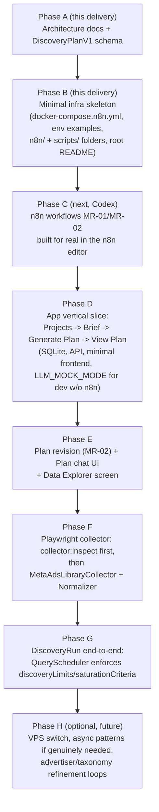

# 12 — MVP Roadmap

## Phased build order

## Phase details

### Phase C — n8n workflows (first real implementation work)
- Build MR-01 and MR-02 in the n8n editor per [08-n8n-workflows.md](08-n8n-workflows.md).
- Paste `DiscoveryPlanV1.schema.json` into both Structured Output Parser nodes.
- Manually create an LLM provider credential in n8n's GUI and pin it on each workflow's Chat
  Model sub-node — no Header Auth credential is needed on the Webhook node for local MVP (see
  [09-security.md](09-security.md)).
- Activate/publish both workflows; confirm Production URLs respond.
- Export both to `n8n/workflows/*.json`.
- **Exit criterion**: a `curl`/Postman call to each Production URL with a realistic body
  (including `availableDiscoveryCapabilities` for MR-01) returns a schema-valid
  `DiscoveryPlanV1` JSON object.

### Phase D — App vertical slice
- SQLite schema + migrations ([05-data-model.md](05-data-model.md)), including the
  `RequestLog` idempotency table (atomic `PROCESSING`-row reservation on
  `UNIQUE(endpoint, requestId)`, before calling n8n) and `DiscoveryPlanVersion.parentVersionId`.
- `n8nClient` module reading `.env` config ([07-api-contract.md](07-api-contract.md)).
- `POST /api/projects`, `POST /api/projects/:id/discovery-plans`, `GET /api/discovery-plans/:id`,
  each honoring the `requestId` idempotency contract.
- Minimal frontend: Projects list → Project Brief form → "Generate Discovery Plan" → plan view
  (can be a readable rendering of the JSON; doesn't need full per-field editing yet).
- `LLM_MOCK_MODE=true` path must work without n8n running at all, for frontend iteration.
- **Exit criterion**: a brief submitted through the real UI produces a stored, valid plan
  version, end to end, through the real n8n container (not just mock mode).

### Phase E — Revision + manual editing + Data Explorer
- `POST /api/discovery-plans/:id/revise` wired to MR-02, plan-chat UI backed by `ChatMessage`,
  version history view, approve/reject actions and the `DRAFT/APPROVED/SUPERSEDED/REJECTED`
  state machine.
- `POST /api/discovery-plans/:id/manual-revision` wired to the plan UI's per-item edit/
  toggle/remove controls (client sends an optional `changeNote`, not a required
  `changeSummary` — the app generates `changeSummary` mechanically) — built as an equal,
  first-class alternative to chat-driven revision, not an afterthought.
- `/data` Data Explorer: list/filter/preview across all tables (including
  `DiscoveryPlanVersion.parentVersionId` as a plain column), destructive actions gated by
  confirmation.
- **Exit criterion**: a user can revise a plan multiple times via chat **and** via direct manual
  edits, see version history for both, approve one version, and browse all resulting data in
  the Data Explorer.

### Phase F — Playwright collector (design already fixed in [10](10-playwright-boundary.md))
- `collector:inspect` first — no selectors written blind.
- `MetaAdsLibraryCollector` + `Normalizer` built against the real, inspected DOM.
- **Exit criterion**: a manual collector run against a real seed query produces normalized
  records in SQLite.

### Phase G — End-to-end DiscoveryRun
- `QueryScheduler` enforces `discoveryLimits`/`saturationCriteria` from the approved plan.
- Full `DiscoveryRun` state machine wired to the UI (start/stop/monitor).
- **Exit criterion**: a run started from the UI against an approved plan stops itself
  correctly at its configured limits/saturation criteria.

### Phase H — Optional/future
- VPS switch performed for real (config-only, per [04](04-future-vps-switch.md)).
- Async patterns only if a concrete long-running job need appears (menu already documented in
  [04](04-future-vps-switch.md); do not build any of them speculatively).
- Advertiser/topic taxonomy refinement loops, traction scoring, analytics — all explicitly
  out of scope for everything above; do not pull them forward without revisiting this roadmap.

## What NOT to build until its phase arrives

- No frontend framework migration (stay vanilla HTML/CSS/JS) unless a concrete, demonstrated
  need appears.
- No Postgres, Redis, message queue, or second Docker service, ever, without a documented ADR
  in [14-decisions.md](14-decisions.md) explaining what concrete requirement justifies it.
- No AI Agent node usage unless a genuine multi-step tool-calling need is identified — default
  to Basic LLM Chain + Structured Output Parser for any new LLM-only workflow.
- No async/callback n8n patterns without a concrete long-running-job requirement (see the
  explicit menu in [04-future-vps-switch.md](04-future-vps-switch.md)).
